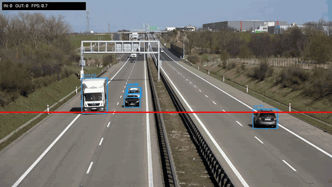
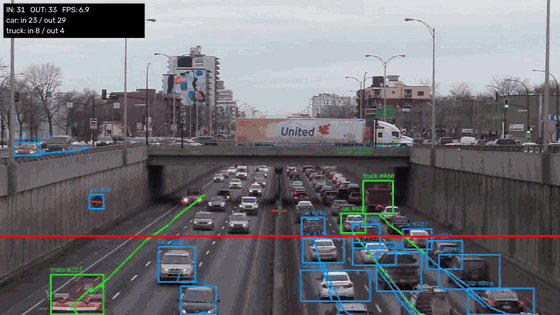
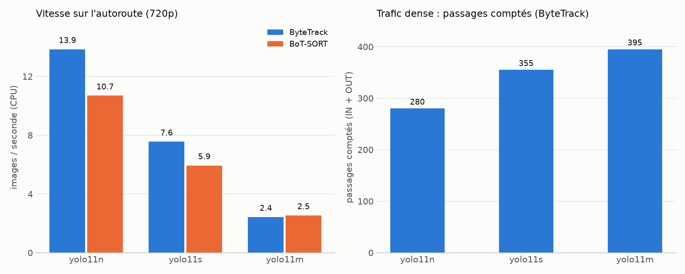

# TrafficVision

[English](README.md) | **Français**

Détection, suivi et comptage de véhicules et de personnes à travers une ligne virtuelle, sur
fichier vidéo, avec YOLO11 et ByteTrack.

> **Ce projet est un MVP** : une première version fonctionnelle qui démontre toute la chaîne
> (détection, suivi, comptage, validation, benchmark et interface web). Voir
> [Limites et pistes d'amélioration](#limites-et-pistes-damélioration) et
> [Licences et usage commercial](#licences-et-usage-commercial).



*`yolo11s` et ByteTrack sur une vidéo d'autoroute (17 premières secondes) : les véhicules sont
suivis et comptés dans chaque sens au franchissement de la ligne rouge.*



*Trafic dense dans les deux sens, extrait de 15 secondes (`yolo11s` et ByteTrack). Cette scène
montre aussi les limites actuelles du MVP : les véhicules à moyenne et longue distance sont en
partie manqués avec la taille d'inférence par défaut, et un panneau fixe est détecté comme une
voiture. Vidéo complète de 43 secondes :*

https://github.com/user-attachments/assets/fc8c5489-08af-4554-933c-8beda6b44f60

## Fonctionnalités
- Détection YOLO11 (poids COCO) filtrée par classe
- Suivi multi-objets (ByteTrack ou BoT-SORT) avec identifiants persistants
- Comptage directionnel (IN / OUT) par classe, chaque objet compté une seule fois
- Trajectoires, compteurs et FPS à l'écran, vidéo annotée et journal CSV des passages
- Interface web pour analyser une vidéo sans ligne de commande

## Installation
Testé avec Python 3.13 sous Windows, processeur uniquement.
```bash
python -m venv .venv
.venv\Scripts\activate        # Linux / macOS : source .venv/bin/activate
pip install -r requirements.txt
```

## Utilisation en ligne de commande
```bash
# Compter les véhicules d'une vidéo (placer le fichier dans data/)
python src/counter.py --source data/traffic.mp4 --show

# Compter des personnes
python src/counter.py --source data/street.mp4 --classes person --show

# Ligne personnalisée (coordonnées relatives x1 y1 x2 y2)
python src/counter.py --source data/traffic.mp4 --line 0.1 0.6 0.9 0.6
```
Sorties : `outputs/result.mp4` (vidéo annotée) et `outputs/events.csv` (journal des passages).

Pour les vidéos 4K, `--imgsz 1280` améliore la détection des véhicules lointains et
`--out-width` (1280 par défaut) limite la taille de la vidéo annotée.

## Application web
Envoyez une vidéo, placez la ligne de comptage sur un aperçu, choisissez le modèle et les classes,
suivez l'analyse en direct, puis récupérez les résultats : compteurs, passages par classe et dans
le temps, vidéo annotée et journal CSV à télécharger.
```bash
streamlit run src/app.py
```
Le calcul s'exécute sur le processeur : la durée analysée est donc limitée (30 s par défaut,
120 s au plus) pour garder un temps de réponse raisonnable.

## Structure du dépôt
| Chemin | Rôle |
|---|---|
| `src/engine.py` | Moteur : détection, suivi, franchissement de ligne, annotation |
| `src/counter.py` | Interface en ligne de commande |
| `src/app.py` | Application web (Streamlit) |
| `src/benchmark.py` | Comparaison de modèles et de trackers face à une vérité terrain |
| `benchmark/ground_truth/` | Vérités terrain (comptages manuels) |
| `docs/` | Validation, benchmark et graphiques |

## Vidéo de test
Les vidéos ne sont pas versionnées. Exemple utilisé pendant le développement (autoroute, 4K,
22 s), issu des exemples de la bibliothèque Roboflow `supervision` :
```bash
curl -L -o data/highway.mp4 https://media.roboflow.com/supervision/video-examples/vehicles.mp4
python src/counter.py --source data/highway.mp4 --imgsz 1280 --line 0 0.6 1 0.6
```
Les vues de dessus (parking filmé à la verticale) donnent de mauvais résultats avec les poids COCO :
préférer une vue en hauteur oblique ou de côté.

## Résultats
Sur une vidéo d'autoroute avec vérité terrain manuelle (9 passages), `yolo11s` + ByteTrack compte
exactement les 9 passages, avec le bon sens, à 7,6 FPS sur CPU ; `yolo11n` est le plus rapide
(13,9 FPS) mais ajoute un passage en trop. Sur une vidéo de trafic dense, le total compté varie
de 280 à 395 selon la taille du modèle (pas de vérité terrain). Détails et limites :
[docs/fr/benchmark.md](docs/fr/benchmark.md) et [docs/fr/validation.md](docs/fr/validation.md).



## Limites et pistes d'amélioration
Limites connues de ce MVP :
- Sur les scènes denses, la détection est incomplète pour les véhicules à moyenne et longue
  distance avec la taille d'inférence par défaut : les comptages sont sous-estimés (voir
  [docs/fr/benchmark.md](docs/fr/benchmark.md)).
- Un objet fixe peut être détecté en permanence comme un véhicule (par exemple un panneau sur un mur).
- Seules les 80 classes COCO sont disponibles, et les poids ne sont pas adaptés à une scène précise.
- La validation repose sur une seule vidéo comptée à la main, avec 9 passages.
- Le calcul s'exécute sur le processeur, ce qui limite la vitesse et la durée analysée.

Améliorations nécessaires :
- **Qualité de détection** : affiner (fine-tuning) le détecteur sur un jeu de données annoté des
  scènes visées (point de vue, éclairage, types de véhicules), et utiliser une taille d'inférence
  plus grande ou un découpage de l'image pour les véhicules lointains.
- **Comptage avancé** : zones polygonales (entrée, sortie, zone d'attente), temps de présence par
  objet, estimation de vitesse (nécessite un étalonnage de la caméra) et statistiques exportées
  (CSV, trafic par minute).
- **Interface web** : tracer la ligne ou les zones directement sur l'aperçu au lieu de curseurs,
  plusieurs lignes par vidéo, et graphiques de statistiques par intervalle de temps.
- **Validation** : davantage de vidéos avec une vérité terrain fiable, dans des conditions variées
  (trafic dense, nuit, pluie).

## Licences et usage commercial
Ce MVP s'appuie sur Ultralytics YOLO11, publié sous licence **AGPL-3.0** (code, poids et trackers
intégrés au paquet). L'AGPL autorise bien l'usage commercial, mais seulement si ses conditions sont
respectées, en particulier mettre le code source complet de l'application à disposition de ses
utilisateurs, y compris lorsqu'elle est proposée comme service en ligne. Pour utiliser YOLO dans un
produit commercial à code fermé, Ultralytics vend une licence Entreprise ; son prix est donné sur
demande et n'est pas publié.

Pour un projet commercial, l'alternative consiste à utiliser des modèles sous licence permissive,
comme **RT-DETR** (version temps réel de DETR, le DEtection TRansformer), dont les modèles publiés
sur Hugging Face sont sous Apache-2.0 (vérifier la fiche de chaque modèle), affinés sur vos propres
données. Ce sont des informations générales, pas un avis juridique.

Je travaille déjà sur une version 100 % souveraine de ce projet.

## Licence
Le code de ce dépôt est publié sous licence MIT, voir [LICENSE](LICENSE).
Les composants tiers, comme Ultralytics, conservent leurs propres licences (voir ci-dessus).
