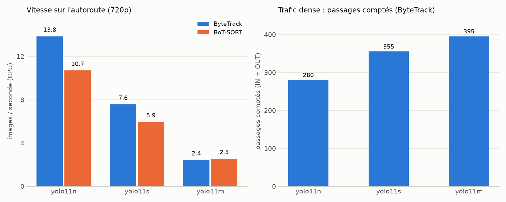

# TrafficVision : comptage d'objets en temps réel (YOLO11 + ByteTrack)

Détection, suivi et comptage de véhicules et de personnes à travers une ligne virtuelle, sur fichier vidéo.

Statut : en développement (voir la feuille de route en bas de page).

## Fonctionnalités
- Détection YOLO11 (COCO) filtrée par classe
- Tracking multi-objets (ByteTrack / BoT-SORT) avec identifiants persistants
- Comptage directionnel (IN / OUT) par classe, sans double comptage
- Trajectoires, HUD (compteurs + FPS), vidéo annotée et journal CSV des passages

## Installation
```bash
python -m venv .venv
.venv\Scripts\activate
pip install -r requirements.txt
```

## Utilisation
```bash
# Vidéo (placer le fichier dans data/)
python src/counter.py --source data/traffic.mp4 --show

# Comptage de personnes
python src/counter.py --source data/street.mp4 --classes person --show

# Ligne personnalisée (coordonnées relatives x1 y1 x2 y2)
python src/counter.py --source data/traffic.mp4 --line 0.1 0.6 0.9 0.6
```
Sorties : `outputs/result.mp4` et `outputs/events.csv`.

Pour les vidéos 4K, `--imgsz 1280` améliore la détection des véhicules lointains et
`--out-width` (1280 par défaut) limite la taille de la vidéo annotée.

## Application web
Une interface permet d'analyser une vidéo sans ligne de commande : envoi du fichier, réglage de la
ligne sur un aperçu, choix du modèle et des classes, suivi en direct, puis résultats (compteurs,
passages par classe et dans le temps, vidéo annotée et journal CSV à télécharger).
```bash
streamlit run src/app.py
```
Le calcul s'exécute sur le processeur : l'application limite la durée analysée (30 s par défaut,
120 s au plus) pour garder un temps de réponse raisonnable.

## Structure du dépôt
| Chemin | Rôle |
|---|---|
| `src/engine.py` | Moteur : détection, suivi, franchissement de ligne, annotation |
| `src/counter.py` | Interface en ligne de commande |
| `src/app.py` | Application web (Streamlit) |
| `src/benchmark.py` | Comparaison modèles et trackers face à une vérité terrain |
| `benchmark/ground_truth/` | Vérités terrain (comptage manuel) |
| `docs/` | Validation, benchmark et graphiques |

## Vidéo de test
Les vidéos ne sont pas versionnées. Exemple utilisé pendant le développement
(autoroute, 4K, 22 s), issue des exemples de la bibliothèque Roboflow `supervision` :
```bash
curl -L -o data/highway.mp4 https://media.roboflow.com/supervision/video-examples/vehicles.mp4
python src/counter.py --source data/highway.mp4 --imgsz 1280 --line 0 0.6 1 0.6
```
Les vues de dessus (parking filmé à la verticale) donnent de mauvais résultats avec les poids COCO :
préférer une vue en hauteur oblique ou de côté.

## Résultats
Sur une vidéo d'autoroute avec vérité terrain manuelle (9 passages), `yolo11s` + ByteTrack compte
exactement les 9 passages, avec le bon sens, à 7,6 FPS sur CPU ; `yolo11n` est le plus rapide
(13,9 FPS) mais ajoute un passage en trop. Sur une vidéo de trafic dense, le total compté varie
de 280 à 395 selon la taille du modèle (pas de vérité terrain). Détails et limites :
[docs/benchmark.md](docs/benchmark.md).



## Feuille de route
- [x] Validation du comptage sur autoroute ([docs/validation.md](docs/validation.md))
- [x] Benchmark yolo11n / s / m et ByteTrack / BoT-SORT ([docs/benchmark.md](docs/benchmark.md))
- [ ] Démo GIF
- [ ] Zones polygonales et temps de présence
- [x] Interface web (Streamlit)
- [ ] Fine-tuning sur dataset custom
- [ ] Export ONNX et déploiement (Docker / Hugging Face Spaces)
