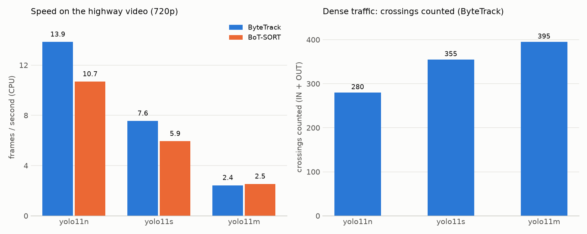

# Benchmark: models x trackers

[Version française](fr/benchmark.md)

Reproduce with: `python src/benchmark.py --source data/highway_720p.mp4 --gt benchmark/ground_truth/highway.json`
Hardware: CPU only (no GPU), `imgsz 640`, `conf 0.3`, classes car / motorcycle / bus / truck.

## 1. Highway (538 frames, 9 ground-truth crossings)
720p copy of `highway.mp4`. Detected crossings are matched to the ground truth (same direction,
within 25 frames).

| Model | Tracker | FPS | IN / OUT | TP | FP | FN | Tracks |
|---|---|---|---|---|---|---|---|
| yolo11n | ByteTrack | **13.9** | 7 / 3 | 9 | 1 | 0 | 23 |
| yolo11n | BoT-SORT | 10.7 | 7 / 3 | 9 | 1 | 0 | 25 |
| yolo11s | ByteTrack | 7.6 | 6 / 3 | 9 | **0** | 0 | 24 |
| yolo11s | BoT-SORT | 5.9 | 7 / 3 | 9 | 1 | 0 | 24 |
| yolo11m | ByteTrack | 2.4 | 6 / 3 | 9 | **0** | 0 | 22 |
| yolo11m | BoT-SORT | 2.5 | 6 / 3 | 9 | **0** | 0 | 22 |

No crossing is missed (FN = 0). The only defect is one extra IN crossing with `yolo11n`
(and with `yolo11s` + BoT-SORT) within the first 8 frames, where the lead truck straddles the
line: either the same vehicle counted twice or the truck itself. I did not isolate which.

## 2. Dense traffic (1275 frames, 1080p, no ground truth)
Counting more than a hundred tightly packed vehicles by hand is not reliable. This video is used
to compare configurations with each other, not to measure accuracy.

| Model | Tracker | FPS | IN / OUT | Total | Tracks |
|---|---|---|---|---|---|
| yolo11n | ByteTrack | 12.0 | 116 / 164 | 280 | 1029 |
| yolo11n | BoT-SORT | 8.4 | 116 / 166 | 282 | 857 |
| yolo11s | ByteTrack | 6.5 | 171 / 184 | 355 | 1057 |
| yolo11m | ByteTrack | 2.6 | 227 / 168 | 395 | 1097 |

## What can be concluded
- **In dense traffic, model size changes the total a lot**: from 280 to 395 crossings (+41%)
  from `n` to `m`. Smaller models probably miss tightly packed or partly hidden vehicles.
  Without a ground truth this is a hypothesis, not a measurement.
- **BoT-SORT brings nothing here**: slower with `n` and `s` (re-identification is off by
  default), same accuracy. It produces fewer tracks (857 against 1029 with `n`), which suggests
  less fragmentation, but the crossing total is the same (282 against 280).
- **Speed / reliability trade-off**: `yolo11n` + ByteTrack is the fastest (about 14 FPS on CPU),
  `yolo11s` + ByteTrack is the best measured accuracy at a moderate cost (7.6 FPS), and `yolo11m`
  is too slow on CPU for a gain that is not demonstrated on the highway.

## Limitations
- Ground truth: a single video, 9 crossings, manual count on sampled frames.
- Speed measurements were not repeated: FPS depends on the machine load.
- The highway was tested on a 720p copy (re-encoded as mp4v). The same `yolo11n` + ByteTrack
  read from the original 4K gave 0 false positives (9 TP): the re-encoded copy is therefore not
  strictly equivalent, and this false positive is sensitive to preprocessing.
- COCO weights do not cover top-down views or night scenes.
